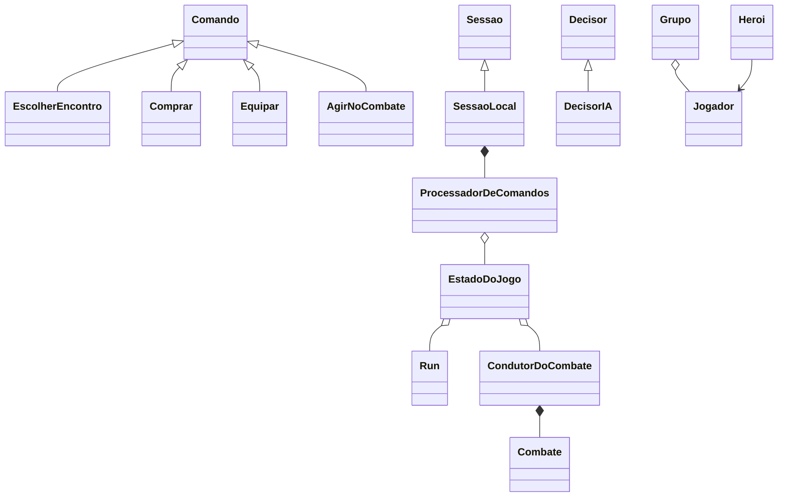
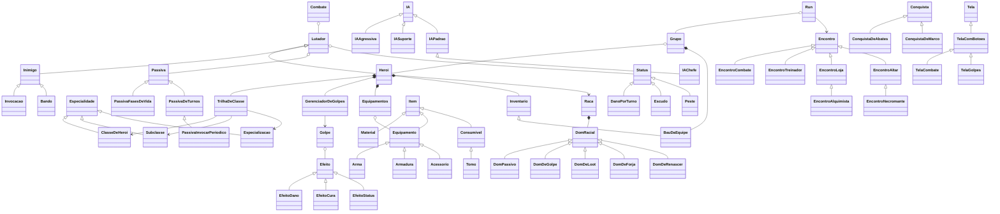

# Ecos da Cripta

Roguelike sombrio por turnos, em grupo, feito em Python com pygame. Projeto independente e de código aberto
(licença MIT).

Monte um grupo de até 5 heróis e atravesse quatro atos, da Floresta Morta à Catedral do Eclipse, com
passagens secretas pelo caminho (o Circo Abandonado e o Reino dos Ratos). Em cada área você escolhe 1 de 3
encontros. Se o grupo cair, a run acaba, mas as Brasas, o prestígio, os abates e as conquistas ficam para a
próxima tentativa.

> As mecânicas foram inspiradas em *An Average Campaign* (Roblox). Todos os nomes, textos,
> personagens e desenhos deste projeto são originais.

---

## Instalar (Windows)

Quem só quer jogar não precisa de Python nem de nada além do instalador. Baixe o `.zip` da versão mais nova na
página de [Releases](../../releases), extraia e:

1. Dê dois cliques em **Instalar Ecos da Cripta 1.2.1.exe**.
2. Como o instalador não tem assinatura paga, o Windows pode mostrar "O Windows protegeu o computador":
   clique em **Mais informações** e depois em **Executar assim mesmo** (só na primeira vez).
3. Clique em **Instalar** (com o atalho na Área de Trabalho já marcado) e depois em **Concluir**: o jogo abre.

O jogo vai para `%LOCALAPPDATA%\Programs\Ecos da Cripta` (sem pedir administrador), com atalhos na Área de
Trabalho e no Menu Iniciar. Para tirar: **Configurações → Aplicativos → Ecos da Cripta → Desinstalar**. Os saves
ficam em `%APPDATA%\Ecos da Cripta` e **nunca são apagados** por desinstalar, reinstalar ou instalar uma versão
nova. Se o jogo fechar por um erro, o motivo fica em `erros.txt`, na mesma pasta dos saves.

### Mandar o jogo para os amigos

Mande o **`dist/Ecos da Cripta <versão> - para enviar.zip`** (~90 MB): dentro dele só há o instalador e o
**Como instalar e jogar.html** (o tutorial com imagens: instalar, a Radmin VPN para jogar de casas diferentes,
criar e entrar na partida, o que fazer se alguém cair e os problemas comuns). O tutorial também fica instalado,
com um atalho no Menu Iniciar. O mais fácil é mandar o link da página de [Releases](../../releases), onde o
mesmo .zip fica para baixar; fora dela, mande por Google Drive, WeTransfer ou parecido (o Discord grátis não
aceita arquivos tão grandes).

Para gerar o instalador e o pacote a partir do código (precisa do PyInstaller no venv e do Inno Setup 6):

```bash
python ferramentas/instalador/construir.py            # -> dist/Ecos da Cripta <versão> - para enviar.zip (~1 min)
python ferramentas/instalador/construir.py --so-pasta # só a pasta dist/Ecos da Cripta/ (sem o instalador)
python ferramentas/instalador/capturas_do_tutorial.py # refaz as imagens do tutorial (quando as telas mudarem)
```

O construtor gera o ícone e o tutorial, empacota o jogo só com o que ele usa (sem o código-fonte, os testes, as
ferramentas, o numpy ou o Pillow), abre o `.exe` sem janela para conferir se ele funciona (`--verificar`: título,
acampamento, uma luta e uma partida em grupo só no PC) e só então monta o instalador e o pacote.

### Lançar uma versão nova

1. Faça as mudanças e confira: `pytest` e jogue um pouco pelo código (`python src/jogar.py`).
2. Aumente a versão em `src/versao.py` (o único lugar dela): `1.1.0` → `1.1.1` num conserto, `1.2.0` num conteúdo novo.
3. Se mudou alguma tela que aparece no tutorial: `python ferramentas/instalador/capturas_do_tutorial.py`.
4. `python ferramentas/instalador/construir.py` → `dist/Ecos da Cripta <versão nova> - para enviar.zip`.
5. Mande o .zip novo. Cada um roda o instalador novo **por cima** (não precisa desinstalar): o progresso fica.

Todos precisam atualizar: o jogo não deixa entrar numa partida com outra versão ou com os dados diferentes.
Terminem a run em grupo antes de atualizar: uma partida salva pelo host numa versão antiga não é retomada na nova.

## Como rodar pelo código

Na raiz do projeto:

```bash
python -m venv .venv
.venv\Scripts\activate             # Windows (no Linux/Mac: source .venv/bin/activate)
pip install -r requirements.txt
python src/jogar.py                # abre o jogo
pytest                             # roda os testes
```

O jogo foi testado com Python 3.13 e pygame 2.6, no Windows. A janela tem 1280×720 (**F11** ou **Alt+Enter**
alternam a tela cheia). Os saves ficam em `%APPDATA%\Ecos da Cripta` (veja [Saves](#saves)); para um save
separado, `python src/jogar.py --perfil B`.

### Combate de teste

Abre direto uma luta, sem mexer no seu progresso. Serve para testar classes, subclasses e inimigos:

```bash
python src/jogar.py --teste guerreiro,mago:criomante,bobo:palhaco_macabro aranha,goblin,goblin_xama
python src/jogar.py --teste ladino aranha_mae --nivel 6 --regiao floresta --semente ABC
python src/jogar.py --teste monge:caminho_do_espirito@gnomo,feiticeira@revenante orc,goblin
python src/jogar.py --teste guerreiro enxame_de_ratos --regiao reino_dos_ratos --area 6
python src/jogar.py --teste guerreiro,sacerdote,mago - --regiao reino_dos_ratos --area corte --nivel 10
```

`--area N` escolhe a área (o cenário daquele trecho da fase; no Reino dos Ratos, a zona), `--area chefe`
abre a luta na sala do chefe e `--area corte` abre o modo difícil do chefe (A Corte Completa: os inimigos vêm do
`regioes.json`, por isso a lista de inimigos é só `-`).

`classe:subclasse` escolhe a subclasse (sem ela, vale a primeira da classe) e `@raca` escolhe a raça. As chaves são as dos
arquivos em `src/roguelike/dados/`.

### Jogar em grupo (rede local)

No título, **Jogar em grupo**: escolha o seu nome e a sua cor e então

- **Criar partida**: você hospeda. O lobby mostra o **código da partida** (ex.: `30AG-00F`) e o seu IP para os
  outros digitarem. Na primeira vez, o Windows pergunta do firewall: permita em **Redes privadas**.
- **Entrar em partida**: digite o código, o IP (`192.168.0.15`) ou `IP:porta`, ou clique numa partida da lista
  (o jogo acha sozinho as partidas da mesma rede).

O lobby fica no acampamento: os heróis de todos sentam em volta da fogueira, com o nome do dono na cor dele.
Cada um escolhe os seus heróis na Capitã (**Ajustar meus heróis**; até 5 heróis no total, de 2 a 4 jogadores),
conversa (Enter manda; acentos funcionam) ou manda um emote, e marca **Pronto**. O host clica **Iniciar** e a run
começa igual para todos. Os painéis **Jogadores** e **Conversa** minimizam no ▲ (a aba da conversa conta as
mensagens novas); se o PC do host estiver em mais de uma rede (ex.: a de casa e a Radmin VPN), o botão do IP troca
qual rede o código mostra.

Na run, o caminho no mapa, as opções dos eventos e "continuar ou fugir" são **votados** (cada carta mostra quem
votou nela; empate é sorteado; depois de 40 s o host decide pelos votos que houver). Nas recompensas, na loja e nos
serviços, o grupo segue quando todos clicarem em continuar. No combate, cada um escolhe só pelos seus heróis; na vez
do herói de outro aparece "Bia escolhendo…" e, se ele demorar mais de 45 s (ou cair da partida), a IA joga por ele.
O registro da luta mostra quem fez cada ação. Cada um compra com o próprio ouro e pode **enviar ouro** a outro (na
loja ou no menu do mapa). No fim, cada um guarda no seu progresso as Brasas, o prestígio das suas classes e as suas
peças, e todos voltam ao lobby para jogar de novo.

**Quedas e retomada.** Quem perde a conexão no meio da run tenta voltar sozinho por até 90 s (a IA joga pelos heróis
dele enquanto isso); quem fechou o jogo entra de novo pelo código (ou pela lista: "Voltar à partida de Ana") e
volta no mesmo ponto, até no meio de uma luta. O host salva a partida a cada ação: se ele fechar ou cair,
**Jogar em grupo → Retomar partida** reabre a run onde parou e espera o grupo entrar de novo pelo código
("Seguir sem quem falta" deixa a IA jogar por quem ainda não voltou). O mapa e o lobby mostram a latência de cada
um (ms) e aparece um aviso de conexão lenta; o baú avisa quando alguém põe ou pega algo, e todos ficam sabendo
quando alguém ganha um lendário.

Para testar com duas cópias no mesmo PC: abra uma com `python src/jogar.py` (cria a partida) e a outra com
`python src/jogar.py --perfil B` (entra em `127.0.0.1` ou pela lista). Pela internet, use uma VPN de jogos
(Radmin VPN, ZeroTier, Tailscale) ou abra a porta 47800 (TCP) no roteador do host. Com a Radmin VPN, todos entram
na mesma rede da Radmin e usam o código que o host vê com "Radmin VPN" (a lista também procura pela Radmin). Os dois
precisam da mesma versão do jogo (o host recusa versões e dados diferentes, com o motivo).

---

## Como jogar

### O ciclo de uma run

1. **Acampamento.** Uma cena com a fogueira, o grupo que você está montando e oito pontos de
   interação (clique, setas + Enter, ou as teclas **1 a 8**, na ordem: Espelho, Grimório, Estudioso,
   Taverneiro, Capitã, Mago Ancião, Baú e Arsenal):
   - **Espelho Antigo:** árvores de talentos de cada classe.
   - **Baú:** troca as skins (roupa, chapéu e arma) de cada classe.
   - **Estudioso do Bestiário:** a página de cada inimigo. Quem você nunca derrotou é só uma
     silhueta "???"; com abates aparecem o nome e os golpes, depois as fraquezas e o loot.
   - **Taverneiro:** Bênçãos (modificadores da run, 5 espaços), **Provisões** (consumíveis
     comprados com Brasas que vão para a sua mochila na próxima run), **Boatos** (dicas que mudam a cada
     run) e **Raridades** (skins raras à venda; a vitrine muda depois de cada run).
   - **Mestre do Grimório:** o catálogo de todos os golpes que cada classe e subclasse pode ter.
     Golpe que nenhum herói teve ainda aparece como "???", com a pista de onde se aprende.
   - **Mago Ancião:** escolhe a **raça** e a **subclasse** de cada herói, com prévia animada (e
     libera raças com Brasas).
   - **Capitã da Expedição:** quantos heróis (1 a 5), classe, aparência, nome e semente. Cada
     cartão revisa o herói (raça, caminho e golpes iniciais) e tem atalhos para o Mago Ancião e o
     Baú. Com a semente vazia, o jogo sorteia uma. A mesma semente gera os mesmos encontros.
   - **Arsenal** (estande de armas): os equipamentos guardados de runs anteriores, que os heróis da
     expedição podem levar emprestados (veja [Progressão permanente](#progressão-permanente)).
   - As escolhas ficam salvas no progresso: dá para ir de um personagem a outro sem perder nada.
   - A cena tem três planos de profundidade: ao fundo, a barraca do Taverneiro entre as tendas e a carroça
     (com a névoa passando no pé delas); no meio, o Espelho, o Mestre do Grimório e o Estudioso à esquerda e o
     Arsenal e o Mago Ancião à direita, com os dois estandartes da expedição marcando o caminho até a taverna; na
     frente, a Capitã e os heróis escolhidos sentados em dois troncos compridos, um de cada lado da fogueira, e o
     Baú no canto. Quem está mais longe
     é desenhado menor (o pixel continua do mesmo tamanho). De vez em quando o Taverneiro serve uma caneca, o
     Estudioso vira a página e a fogueira estala.
   - Com o mouse em cima (ou o foco do teclado), o personagem ganha um contorno dourado e uma placa com o nome
     e a função.
   - No canto superior esquerdo, o **prestígio** de cada classe do grupo (barra de XP e o próximo
     marco, como a subclasse do prestígio 3). No direito, **Brasas**, **Bênçãos** e **Insígnias**
     (medalhas das conquistas e escudos de prestígio); clique nesse quadro para ver tudo (o que falta
     e o prêmio de cada uma).
2. **Mapa da área.** Mostra 3 encontros para escolher. As estrelas indicam a dificuldade e a recompensa.
3. **Encontro.** Pode ser combate, evento, loja, treinador, altar, necromante, descanso ou passagem.
4. **Descanso.** Entre as áreas o grupo recupera um pouco de vida.
5. **Chefe.** Fica na última área de cada região.
6. **Fim da run.** Vencendo ou perdendo, você ganha **Brasas** (moeda permanente) e **prestígio**
   para as classes que jogou.

A run é salva sozinha no mapa e ao escolher um encontro. Se o jogo fechar no meio de um
encontro, ao continuar você volta para o começo **desse mesmo** encontro: não dá para fugir de
uma luta fechando o jogo.

### Combate

- A ordem de ação é sorteada pela **iniciativa** a cada rodada (fila no topo da tela).
- Cada herói tem **energia**: começa com 2 (máximo 10). Os golpes fortes custam energia.
- Na sua vez você tem três opções:
  - **Lutar:** usa um dos seus golpes.
  - **Itens:** usa um consumível da mochila do herói.
  - **Concentrar:** ganha +2 de energia.
- Ao escolher um golpe, uma **faixa curta** mostra dano, custo, efeito e alvo. Na escolha do alvo,
  uma seta vermelha marca o alvo e quem não pode ser escolhido fica apagado.
- Cada golpe sorteia acerto, esquiva, bloqueio e crítico separadamente.
- Existem 20 efeitos de status (sangramento, veneno, queimadura, atordoado, escudo, provocação...).
  Passe o mouse no ícone para ver o que ele faz.
- Os chefes têm padrões de energia, e a intenção do chefe aparece acima dele.
- O consumível no espaço **Uso automático** é usado sozinho no início de cada combate.
- Inimigos derrotados largam itens, ouro e XP. O **loot é separado por jogador** (pensando no co-op): cada um
  sorteia o seu e quem tem o mesmo número de heróis ganha a mesma quantidade de **prêmios** (3 + 2 por herói +
  meio por estrela acima de 1). Cada prêmio é uma peça de equipamento (mais chance em elites e chefes; as peças
  preferem os atributos principais dos seus heróis) ou um item das tabelas dos inimigos e da fase. **Chefe:
  todos ganham uma peça lendária** (no Ato I, épica, com 25% de chance de lendária: lendária já no primeiro chefe
  dobrava as vitórias); mini-chefe: épica (às vezes lendária). Os eventos também dão prêmios a cada jogador, maiores
  nas opções arriscadas. Com vários jogadores, a janela de vitória tem uma aba para cada um (Tab troca).
- O **registro** da luta pode ser recolhido (tecla **L**) para o menu ganhar espaço.

### Golpes, grimório e evolução

- Cada herói usa **até 6 golpes** no combate (mais o golpe que a arma ensina e o golpe da raça, se tiver).
- Golpes novos chegam pela classe (níveis 3 e 6), pela subclasse (níveis 1, 4 e 7), pela
  especialização, por **tomos** (que caem dos inimigos nomeados e aparecem nas lojas) e por eventos.
- **Golpes raros:** cada classe tem um golpe raro liberado por uma conquista (ex.: derrotar o
  Senhor da Guerra Orc libera a *Lâmina do Rei Caído* do Guerreiro). Depois de liberado, todo
  herói da classe o aprende num nível da run. O Mestre do Grimório mostra a conquista e o progresso.
- Com os espaços cheios, abre a tela de **golpe novo**: as cartas comparam o golpe novo com
  cada um dos atuais ("Se trocar: dano +2, custo +1"). Você troca um pelo novo ou guarda o novo.
- **Nada se perde:** o golpe que sai vai para o **grimório**, e fora do combate dá para trocar à
  vontade (Grupo > "Golpes e grimório").
- **Evolução:** alguns golpes se aprimoram sozinhos quando o requisito é cumprido. Por exemplo,
  Bola de Fogo vira **Inferno** quando o Piromante se torna **Arauto das Cinzas**. Outros
  evoluem no nível 8 ou ao derrotar um chefe. Aparece o aviso "Golpe aprimorado!".

### Teclas

Todas as telas funcionam por teclado **ou** mouse. As teclas abaixo são as padrão e podem ser
trocadas em **Opções > Controles** (cada ação aceita 2 teclas).

| Onde | Tecla | Ação |
|---|---|---|
| Qualquer tela | **setas** ou **WASD** | mover a seleção entre os botões |
| Qualquer tela | **Enter** | apertar o botão selecionado |
| Qualquer tela | **ESC** / botão direito | voltar (no combate: voltar ao menu ou pausar) |
| Qualquer tela | **F11** ou **Alt+Enter** | tela cheia |
| Mapa | **1 2 3** | escolher o encontro |
| Mapa e loja | **G** / **B** / **F** | Grupo / Baú / Fabricação |
| Grupo | **TAB** | próximo herói |
| Combate | **1–6** | Lutar / Itens / Concentrar, depois o golpe ou o item |
| Combate | **V** | velocidade do combate (1×, 1,5×, 2×, 3×) |
| Combate | **ESPAÇO** (segurar) | acelerar as animações |
| Combate | **L** | mostrar/ocultar o registro |

### Opções

No título, no acampamento, no menu do mapa (ESC) ou na pausa do combate:

- volume da música e dos efeitos;
- velocidade do combate e do texto (eventos aparecem letra por letra);
- tela cheia;
- bichos no acampamento (mostrar ou esconder o Rato Branco; a linha só aparece depois de liberá-lo);
- remapear as teclas;
- **abrir a pasta dos saves** (no Explorador de Arquivos), para fazer uma cópia de segurança;
- **apagar save e começar do zero:** apaga `progresso.json` e `run.json` (Brasas, prestígio,
  conquistas, arsenal, run em andamento...) e volta ao título. Pede confirmação; as opções e as
  teclas continuam.

Ficam salvas em `opcoes.json`, na pasta dos saves, separadas do progresso. Ações sem volta, como **vender** ou
partir com uma run salva, pedem confirmação, e o foco começa sempre em "Cancelar".

### Heróis, subclasses e especializações

Cada herói tem os atributos **FOR, DES, CON, INT, FÉ, SOR e CAR**, que geram os valores derivados
(vida, dano, crítico, esquiva, bloqueio...). Ao subir de nível ele ganha pontos de atributo e de golpe.

- A **subclasse** é escolhida na Capitã antes de partir. A 1ª de cada classe vem liberada; as outras
  abrem com o **prestígio da classe** (níveis 3 e 6). Cada subclasse tem roupa própria.
- Durante a run, a partir do nível 5, um **treinador** transforma a subclasse na sua
  **especialização**. Ela dá bônus, uma passiva, um golpe novo, roupa nova e às vezes uma evolução
  de golpe. Cada especialização tem uma região; a Catedral ensina todas.

| Classe | Subclasse → Especialização |
|---|---|
| Guerreiro | Cavaleiro → Guardião Juramentado · Berserker → Carniceiro · Gladiador → Campeão da Arena |
| Ladino | Sombra → Ceifador Silencioso · Duelista → Mestre-Esgrimista · Envenenador → Praga Viva |
| Mago | Piromante → Arauto das Cinzas · Criomante → Coração do Inverno · Eletromante → Artífice Rúnico · Necromante → Bruxo de Sangue |
| Sacerdote | Druida → Guardião do Bosque · Inquisidor → Martelo da Fé · Ocultista → Oráculo Profano |
| Bárbaro | Fera → Besta Ancestral · Elementalista → Tempestade Viva · Quebra-Escudos → Titã |
| Patrulheira | Andarilha Feérica → Voz do Bosque · Caçadora das Trevas → Caçadora de Monstros · Armadilheira → Mestra das Armadilhas |
| Bardo | Bardo do Valor → Hino de Guerra · Bardo dos Sussurros → Voz do Abismo · Menestrel das Lâminas → Dançarino de Lâminas |
| **Bobo da Corte** | Arlequim → Mestre das Máscaras · Palhaço Macabro → Riso da Cripta · Malabarista de Facas → Chuva de Aço |
| **Monge** | Punho de Ferro → Dragão Interior · Caminho do Espírito → Voz dos Ancestrais · Mestre da Serenidade → Lótus Eterno |
| **Feiticeira** | Senhora dos Familiares → Mãe da Ninhada · Bruxa da Lua → Rainha do Eclipse · Senhora das Maldições → Bruxa Velha |
| *Médico da Peste* (secreta) | Doutor da Peste → Mestre da Quarentena · Boticário → Envenenador da Corte · Cirurgião do Esgoto → Anatomista Proibido |
| *Senhor dos Ratos* (secreta) | Rei dos Bandos → Pai dos Ratos · Senhor das Moscas → Senhor do Enxame · Profeta da Praga → Arauto do Fim |

O **Bobo da Corte** é a classe de caos e truques: sorte, esquiva, maldições e chuvas de facas.
O **Monge** luta de mãos nuas e chama **espíritos** (Garça, Tigre e Macacos espirituais); a
**Feiticeira** amaldiçoa e chama **familiares** (Corvo, Gato Negro e Sapo Venenoso). Os familiares
lutam do lado do grupo e agem sozinhos, como o Lobo Espectral e a Fada.

As **classes secretas** só aparecem depois de uma conquista (`"requer"` no `classes.json`), e o acampamento anuncia o
herói novo uma vez: o **Médico da Peste** (suporte: cura, tira a Peste, frascos e venenos) chega ao vencer a Rainha
dos Ratos; o **Senhor dos Ratos** (invocador: ratos, ratazanas e moscas, Peste e dreno de vida), ao vencer A Corte
Completa.

### Raças

Cada herói tem uma raça, escolhida e liberada (com Brasas) no Mago Ancião. A raça dá bônus e penalidades,
imunidades, um traço visual (desenhado por cima de qualquer roupa) e um **dom**:

| Raça | Dom |
|---|---|
| Humano | +10% de XP e 1 ponto de atributo a cada 2 níveis |
| Gnomo (gorro vermelho) | furtividade: é muito menos atacado; chance de item extra por combate |
| Draconiano (chifres) | +25% de dano de fogo; golpe **Metamorfose** (vira dragão por 3 turnos, recarga 6); fraco ao gelo |
| Anão (barba trançada) | forja anã: 5 itens lendários que só ele fabrica |
| Elfo Sombrio (orelhas) | começa o combate Evasivo; frágil |
| Meio-Orc (presas) | Fúria com pouca vida |
| Morto-Vivo (olhos azuis) | **renasce 1 vez por combate**; imune a veneno e sangramento; cura recebida pela metade |
| Hemófago (olhos vermelhos) | rouba vida, mais ainda de quem sangra |
| Meio-Demônio (chifres negros) | +25% de dano de sombra; pode amaldiçoar quem acerta; fraco à luz |

### Elementos

Todo golpe tem um elemento: físico, fogo, gelo, raio, veneno, luz ou sombra (e os status também:
queimadura = fogo, veneno = veneno). Cada família de inimigo tem fraquezas e resistências
(`elementos.json`): mortos-vivos são fracos à luz e resistem a veneno, golens são fracos ao raio,
dragões resistem ao fogo... No combate aparece **"Fraco!"** ou **"Resistente"** e a dica do
inimigo (passar o mouse) lista as afinidades.

### Regiões (fases) e atos

A run passa por **atos**. Cada ato tem fases alternativas; ao vencer o chefe de um ato, o mapa mostra
**dois portões** com fases do próximo ato e você escolhe. Cada fase (inclusive as do ato final) tem
**10 a 15 áreas** sorteadas pela semente (`regioes.json` → `progressao.areas_por_fase` e
`areas_do_final`). Ao entrar numa fase aparece a tela de título dela (ato, nome e frase).

| Ato | Fases | Chefe |
|---|---|---|
| Ato I | Floresta Morta · Bosque Carmesim | Mãe Aranha · Mãe-Raiz |
| Ato II | Minas Profundas · Pântano dos Afogados · Minas de Brasa | Golem da Forja · Barqueiro Sem Rosto · Forjador Antigo |
| Ato III | Catacumbas da Ordem Caída · Cidadela Congelada | Inquisidor Penitente · Rainha de Gelo Eterno |
| Ato Final | Catedral-Masmorra · Catedral do Eclipse (+ vaga secreta "O Enxame") | Dragão Ósseo · Bispo Eclipsado |
| (passagem) | Circo Abandonado: aparece na Catedral e, ao terminar, volta para ela | Rei Sombrio |
| (secreta) | Reino dos Ratos: o Rato Branco leva até ele a partir das Minas Profundas, das Minas de Brasa ou das Catacumbas; ao terminar, volta | Rei dos Ratos e Rainha dos Ratos |

Uma fase com `"disponivel": false` no `regioes.json` aparece como portão **selado** (o cenário é o
provisório tingido pela `paleta`); um ato sem nenhuma fase pronta é pulado. Cada fase ou ato pode ter
`multiplicador_inimigos` (o da fase substitui o do ato): é o ajuste fino de dificuldade de cada rota.

**O que cada fase nova traz:**

| Fase | Inimigos | Mecânica do chefe | Itens e materiais |
|---|---|---|---|
| Bosque Carmesim | Lobo Sarnento (matilha), Fungo Esporento, Espantalho Possuído | Mãe-Raiz invoca raízes, regenera com elas, enraíza | Presa de Lobo, Seiva Viva, Arco de Galho Retorcido |
| Pântano dos Afogados | Afogado (puxa para o fim da fila), Sanguessuga, Bruxa do Lodo, Sapo-Boi | Barqueiro cobra **pedágio** (ouro ou consumível) se ninguém o acerta | Lodo Negro, Escama de Afogado, Moeda do Barqueiro, Botas de Junco (imune a lodo) |
| Minas de Brasa | Kobold Dinamiteiro (explode ao morrer), Salamandra, Minerador (volta 1 vez) | Forjador Antigo reforja o escudo e desgasta as armas (a Pedra de Amolar conserta) | Minério de Brasa, Martelo e Couraça lendários **anões** |
| Catacumbas da Ordem Caída | Cavaleiro Ossudo (apara o 1º golpe), Monge Flagelante, Relicário Vivo, Enxame de Ratos | Inquisidor em 2 fases; Fogo Sagrado fere mais demônios e mortos-vivos | Osso Consagrado, Ferro de Cruzada, Fragmento de Relíquia, skin Elmo do Cavaleiro Ossudo |
| Cidadela Congelada (sempre noite) | Sentinela de Gelo (revida), Lobo Espectral (golpes físicos ferem pouco), Arauto da Nevasca, Draconiano Renegado | Rainha congela o salão a cada 5 turnos; escudo de gelo só racha com **fogo** | Cristal Glacial, Pele de Lobo Espectral, Lágrima Congelada, Capa de Pele Branca (imune a congelar), Cajado do Inverno, Brasa Engarrafada, Hidromel Quente |
| Catedral do Eclipse | Clérigo do Eclipse, Gárgula Viva (pele de pedra), **Sombra do Herói** (copia um herói do grupo), Anjo Corrompido | Bispo Eclipsado em 3 fases: homem de luz que se cura → fundido aos vitrais, invoca Sombras do grupo → **Dragão do Eclipse** (um Draconiano em Forma de Dragão causa +60%) | Vitral Partido, Cinza do Eclipse, Coração do Eclipse; lendários anões Lâmina do Alvorecer e **Grimório Sem Nome (7º espaço de golpe)** |

**Extras:**

- **Chefes secretos** (`regioes.json` → `chefes_secretos`): o **Mercador Mascarado** aparece às vezes
  como opção no mapa dos Atos II e III; vencê-lo abre a loja dele na Taverna (aba Mascarado). **O
  Primeiro Herói** aparece ao lado do chefe final depois que você já venceu o Dragão Ósseo e o Bispo
  Eclipsado; vencê-lo também vence a run.
- **O Rato Branco** (`regioes.json` → `guias`): às vezes, nas Catacumbas e nas Minas, um rato branco aparece
  no mapa e atravessa o cenário correndo. Segui-lo leva a um esconderijo (com Queijo Mofado); segui-lo de novo,
  em qualquer run, revela um bueiro escondido: a passagem para o **Reino dos Ratos** (fase secreta em três zonas:
  Galerias Fétidas, Mercado Roedor e Catedral Roída, cada uma com música própria, e o Salão do Trono). Quantas vezes
  ele já foi seguido fica salvo no progresso.
- **Ambientes de combate** (Reino dos Ratos, `roguelike/ambiente.py`): cada zona da fase pode ter **água subindo**
  (sobe a cada 3 rodadas; água funda enfraquece o fogo e, na alta, os heróis ficam Encharcados e os ratos nadadores
  ganham força) e **escuridão** (sem luz, alguns inimigos viram só um par de olhos e não podem ser alvo de golpes de um
  alvo só; lanternas, tochas, velas e óleo de lamparina dão luz). Um painel no canto do combate mostra o estado.
  Bichos com `"boia": true` (os ratos) sobem até a superfície da água em vez de afundar.
- **Peste** (Reino dos Ratos, status `peste` em `regras.json`, classe `Peste` em `status.py`): doença em níveis 1–5
  que **segue entre as lutas** (`heroi.peste`). 1–2: perde vida a cada turno; 3–4: e recebe menos cura; 5: **Febre
  Negra** (o herói age sem rumo 1 turno, golpe e alvo sorteados, e a doença volta ao 3). Cura: **Tônico do Médico**
  (também no mapa), fogueira (Descanso Maior ou fase nova) ou curas de luz e purificar (−1 nível). Mortos-vivos
  resistem, anões um pouco, gnomos pegam mais fácil (`"resiste_peste"` nos modificadores da raça). O ícone aparece
  no painel do grupo no mapa.
- **Bandos** (`roguelike/bando.py`): um lutador que é um monte de bichos ("Ratos ×12"). O contador cai com a vida,
  o dano cai junto, golpes em área machucam mais e de um alvo só, menos; cada bicho conta um abate. A tela desenha
  vários ratos (`telas/combate/visual_bando.py`). Ratos novos do Reino: Bando de Ratos, Ratazana Gigante (tanque) e
  Rato da Peste.
- **Ratos especiais** (Reino dos Ratos): o **Ladrão** rouba um consumível da mochila e foge em 2 turnos (derrotá-lo
  devolve o item); o **Nadador** mergulha na água funda (só golpes em área o alcançam; o bote dele saindo da água
  machuca mais); o **Bombardeiro** explode ao morrer em todo mundo por perto, heróis e ratos, e, ferido, acende o
  pavio e se joga; o **Alquimista** joga frascos de veneno e cegueira e cura os ratos; o **Xamã** seca os atributos
  dos heróis e reergue ratos caídos; o **Guarda Real** entra na frente dos golpes contra chefes ou ratos feridos; o
  **Arauto**, se sobreviver 2 turnos, toca a corneta e chama reforços (inimigos de verdade).
- **Humanos bubônicos** (Reino dos Ratos, família Bubônicos): o **Homem Bubônico**, lento e forte, solta uma ninhada de
  ratos ao cair; o **Mendigo** pede esmola e, se ninguém o atacar, bate a carteira do grupo (devolve ao cair); o
  **Carrasco** (elite) causa o dobro de dano em heróis abaixo de 25% da vida; a **Freira Roída** cura os ratos e
  espalha a Peste com hinos. Cada trecho do Reino (Galerias, Mercado, Catedral) tem os seus inimigos ("inimigos" na zona).
- **Mini-chefes do Reino** (um por zona, "mini_chefes" na zona, com "escolta" na ficha): o **Médico da Peste
  Corrompido** (Galerias) drena a vida do grupo e "trata" os seus pacientes; o **Flautista Caído** (Catedral Roída)
  chama bandos e **encanta** heróis (status Encantado: no turno dele, ataca um aliado). Ele deixa a **Flauta do Caçador
  de Ratos**, arma secundária que encanta os bandos inimigos.
- **Eventos do Reino** (com "zonas": só aparecem naquele trecho): o **Mercado Roedor** (o Rato Mercador troca queijos ou
  consumíveis; roubá-lo traz a Guarda Real na luta seguinte), o **Prisioneiro na Gaiola** (coitado ou bubônico
  disfarçado?), o **Banquete do Rei** (cura que pode dar Peste) e o **Altar do Queijo** (bênção até vencer o chefe, ou
  roubar e enfrentar um chefe mais fraco porém furioso). Nas Galerias, o **Enxame de Ratos** vem em 3 ondas seguidas
  (combate em ondas, `roguelike/ondas.py`): entre uma e outra o grupo recupera o fôlego, pode usar itens e escolhe
  continuar (mais estrelas a cada onda) ou fugir com o que já ganhou; quem vence as 3 revira o ninho.
- **O Rei dos Ratos** (chefe do Reino): a cada 3 turnos proclama um **Édito Real** (proibido curar, usar magia,
  atacar o Rei, ou ajoelhem-se), mostrado num pergaminho; quem desobedece perde 25% da vida. Cobra impostos (rouba
  ouro e fica mais duro; devolve em dobro ao cair), chama a Corte Real e, ferido, come o **Queijo Real** (um objeto na
  luta que dá para destruir antes). Abaixo de 50% entra em Fúria. Na primeira vez que cai, foge para o trono: depois de
  uma pausa para itens, desce a **Rainha dos Ratos**, uma roda de 8 ratos presos pelas caudas (Mordedores, Pestilentos,
  Guinchos que silenciam e um Curandeiro) que gira a cada rodada; só os 2 da frente agem e podem ser atingidos. Com metade
  da roda caída o nó de caudas fica exposto e acertá-lo fere todos. Quando ela cai, o Rei salta do trono para o fim.
  Cada um tem a sua música (`reino_rei`, um minueto gordo e torto; `reino_rainha`, a roda que não para).
- **A Corte Completa** (modo difícil, `regioes.json` → `modo_dificil`): depois da 1ª vitória sobre o Rei, a sala do
  chefe oferece uma 2ª carta. O Rei não foge: governa do trono (ninguém o atinge, mas ele proclama Éditos e cobra
  impostos) enquanto a Rainha luta, e desce em Fúria quando ela cai. Vale +50% de XP e ouro e um item épico.
- **Itens do Reino:** 9 materiais (Pelo Sarnento, Tampinha Dourada, Nó de Caudas...), consumíveis (Veneno de Rato,
  Sais de Cheiro, Ratoeira, Vela de Sebo), peças avulsas (Pingente do Nó de Caudas, Machado do Carrasco, Rato de
  Estimação no ombro...) e **três sets**: Realeza Roedora (mais ouro; com 4 peças os ratos às vezes viram contra os
  outros, mas quem veste começa toda luta com Peste 1), Traje do Médico da Peste (imune à Peste; com 4 peças as curas
  tiram Peste e veneno) e Guarda Real Roedora (entra na frente do aliado ferido). As melhores receitas são da forja anã.
- **O Rato Branco no acampamento:** depois de vencer o Reino, ele fica perto da fogueira (as Opções deixam esconder).
- **Elites de aura dourada** (`regras.json` → `dourados`): às vezes um inimigo de um combate comum,
  horda ou elite vem com contorno dourado: mais vida e dano, mais XP e um equipamento raro garantido.
- **Provisões novas do Taverneiro:** Ensopado da Taverna (cura o grupo todo), Mapa Rasgado (troca
  os caminhos à frente no mapa) e Incenso (os inimigos da próxima luta começam amedrontados). Os
  dois últimos só se usam no mapa (inventário).
- **Bestiário:** todo inimigo tem página e contador de abates; os chefes ganham uma **história**
  (botão "Ler a história", `lore.json`) depois de vencidos; os chefes secretos ficam na seção Segredos. A do Rei e a
  da Rainha dos Ratos vêm em duas partes: o resto só com 3 vitórias (`regras.json` → `bestiario.partes_da_lore`).

**Dia e noite:** nas regiões a céu aberto (Floresta e Circo) a primeira área é de dia e a área do chefe
é à noite; no meio, o céu passa pelo entardecer. O cabeçalho mostra a hora ("Área 3/8 · Tarde"), as
luzes do cenário (cogumelos, lanternas) acendem conforme escurece e os vagalumes só aparecem à noite.
Minas e Catedral são lugares cobertos (sempre na luz de tochas). Quais fases têm céu fica no
`regioes.json` (`"ciclo": true`); `"inimigos_noturnos"` só aparecem quando escurece.

**Mecânicas de chefe reutilizáveis** (passivas no `inimigos.json`): `fases_de_vida` (troca golpes,
sprite, cura ou invoca ao cair abaixo de cada limiar, sem pular fase num golpe só),
`invocar_periodico`, `escudo_elemental` (só o elemento certo racha o escudo), `a_cada_n_turnos`
(golpe extra ou status em todo o grupo) e `regenerar_com_invocacoes`. Para inimigos comuns também:
`ao_morrer` (status ou explosão), `matilha`, `pedagio`, `bloquear_primeiro`, `imaterial` (um elemento
fere menos), `copiar_heroi` (vira a sombra de um herói do grupo) e `fraqueza_contra` (leva mais dano de
quem está com um status). A IA de chefe aceita `"vida_abaixo"` no `padrao` (ex.: curar-se só ferido).

Os inimigos ficam mais fortes a cada área vencida e de acordo com o tamanho do grupo (veja
[Balanceamento](#balanceamento)).

### Itens, baú e fabricação

- **Mochila:** 50 pilhas, do jogador (os heróis dele dividem: em combate, qualquer um usa qualquer poção dela). O
  loot, as compras e as provisões caem nela; cheia, o resto vai para o **baú da equipe** (sem limite, com histórico de
  quem guardou e quem pegou o quê). O **ouro** também é de cada jogador (no solo, o seu).
- **Equipamento (8 espaços + uso automático):** cabeça, peitoral, calças, botas, capa, amuleto,
  arma principal e arma secundária. Arma de duas mãos ocupa também a secundária; armas leves
  (faca, adagas) vão em qualquer mão. Alguns itens ensinam um golpe enquanto estão equipados, e
  as peças aparecem no sprite do herói nos 8 espaços (cabeça, peitoral, calças, botas, capa, amuleto
  e as duas armas), tingidas com a cor da peça, do set ou da raridade; com arma equipada, o herói
  troca a arma da classe pela da peça (a skin de chapéu, se houver, manda na cabeça).
- **Raridades:** Comum, Incomum, Raro, Épico, Lendário e **Amaldiçoado** (muito forte, com um preço,
  e só sai do herói na próxima fogueira: Descanso Maior ou fase nova).
- **Afixos:** peças raras ou melhores que caem ganham 1 a 3 afixos sorteados (`afixos.json`), com
  trocas como "+dano, +dano recebido". Viram um exemplar com nome próprio ("... da Fúria +1").
- **Sets** (`sets.json`): Vigília do Coveiro, Ferro Negro e os três do Reino dos Ratos (Realeza Roedora, Traje do
  Médico da Peste e Guarda Real Roedora), com bônus de 2, 3 e 4 peças.
- **Inventário** (tecla **I** ou botão no mapa; no acampamento, o estande de armas): a **mochila** à esquerda, o
  herói com os 8 espaços no meio (os retratos dos seus heróis em cima: clique, Q/E ou 1 a 5) e o **baú da
  equipe** à direita; embaixo, os 12 atributos ao vivo com ▲ verde / ▼ vermelho ao passar o mouse numa peça.
  Busca pelo nome e filtros (tipo, espaço, raridade) e ordem (raridade, nome, tipo) para as duas grades.
  Duplo clique ou arrastar equipa; arrastar de volta para uma grade tira. **Shift+clique** (ou arrastar até a
  outra grade) leva a pilha inteira entre a mochila e o baú; **Ctrl+clique** marca vários e "Mover marcados"
  leva todos; os botões de baixo levam todos os materiais ou todos os consumíveis. Botão direito: equipar, usar,
  guardar 1 ou todos, vender (na loja), descartar. **Quem se beneficia**: cada peça mostra uma seta verde e o rosto
  do herói (de qualquer jogador) que mais ganha com ela, e a dica compara com o equipado de cada herói do grupo; em
  grupo, a peça da sua mochila que só serve para o herói de outro jogador brilha (mande ao baú). "Histórico do baú"
  mostra quem guardou e quem pegou o quê. Em combate, só os consumíveis (menu Itens).
- **Atributos de equipamento:** HP, energia, ataque, magia, defesa, resistência mágica,
  velocidade, precisão (anula esquiva), esquiva, crítico, furtividade e sorte. Peças podem ser
  restritas a classes ou raças.
- **Tomos:** ensinam um golpe a quem os lê, fora do combate (menu do item no Grupo).
- **Fabricação:** as receitas usam materiais da mochila e do baú. Algumas são **escondidas** e só aparecem
  quando você pega um ingrediente especial (minério, peça do circo, alma de chefe, materiais das
  fases novas) ou compra a receita numa loja. As **lendárias anãs** só se forjam com um Anão no
  grupo e ficam liberadas para sempre depois de vencer o chefe delas (`liberada_por`).
- O **mercador** e a **alquimista** vendem itens (com o seu ouro). Você pode vender o que está na mochila ou no
  baú por 40% do preço.

### Progressão permanente

| O quê | Onde | Como |
|---|---|---|
| **Brasas** | ganhas no fim da run (áreas, chefes, vitória) | compram bênçãos, raças e reiniciam árvores de talento |
| **Prestígio** | por classe, até o nível 25 | cada nível dá 3 pontos de talento; os níveis 3 e 6 liberam subclasses |
| **Bênçãos** | Taverneiro | 15 bênçãos (10 a 300 Brasas); algumas só aparecem depois de uma conquista |
| **Abates** | contados em todas as runs | alimentam as conquistas ("Derrote 10 Cavaleiros Esqueleto: 7/10") |
| **Conquistas** | automáticas | 34 conquistas (abates e marcos: chefe vencido, região, vitória, feitos como "vencer o Reino sem pegar a Peste"); 23 liberam uma skin e 12 liberam um golpe raro (A Flauta Calada libera os dois) |
| **Skins** | Baú | camadas de **roupa**, **chapéu** e **arma**, só visuais, por classe; as de conquista se liberam jogando e as raras são compradas na vitrine do Taverneiro |
| **Golpes raros** | conquistas | 12 golpes, um por classe (Mestre do Grimório mostra como liberar) |
| **Classes secretas** | conquistas | Médico da Peste (vencer a Rainha dos Ratos) e Senhor dos Ratos (vencer A Corte Completa) |
| **Bestiário** | abates | páginas dos inimigos: nome, golpes, fraquezas, loot e a história dos chefes |
| **Ameaça** | cada run vencida | sobe 1 nível (até 15): os inimigos ganham +3% de vida e +1,5% de dano por nível, e as Brasas da run +6% por nível (`regras.json` → `ameaca`) |
| **Loja do Mascarado** | Taverna, depois de vencer o Mercador Mascarado | materiais raros das fases novas como provisão da próxima run |
| **Arsenal** | estande de armas, ao lado do Mago Ancião | guarda os equipamentos de runs **vencidas** ou terminadas pela **fuga**; cada herói da expedição pode partir com peças dele (emprestadas: voltam sempre) |

**Sair da run (fuga):** no menu do mapa (Esc), "Sair da run" faz o grupo enfrentar um guardião:
um chefe sorteado entre as fases já alcançáveis, mais forte que o normal. Vencendo, a run acaba e
os equipamentos vão para o arsenal; perdendo, é derrota.

**Janela:** o jogo desenha sempre em 1280x720 e encaixa a imagem na janela (que já abre do tamanho
que cabe no monitor e pode ser redimensionada) ou na tela cheia (F11 ou Alt+Enter), com faixas pretas.

---

## Para quem vai mexer no código

### Organização

```
src/
  jogar.py              ponto de entrada do roguelike (--teste, --perfil)
  caminhos.py           todas as pastas: assets e dados (só leitura) e a pasta do jogador (saves)
  versao.py             nome e versão do jogo (escritos só aqui)
  audio.py              música e efeitos (ignora o que faltar)
  efeitos.py            partículas, brilhos e projéteis do combate e do acampamento
  roguelike/            REGRAS DO JOGO (não usa pygame; tudo testável)
    dados/              *.json com todos os números e o conteúdo
    lutador.py          Lutador -> Heroi / Inimigo -> Invocacao (bando.py: Inimigo -> Bando)
    especialidades.py   Especialidade -> Subclasse / Especializacao; TrilhaDeClasse
    classes.py          ClasseDeHeroi (também uma Especialidade) e criar_heroi()
    golpes.py           Golpe (raros, recarga, elemento), evolução e GerenciadorDeGolpes (6 espaços + grimório)
    combate.py          Combate: turnos, golpes, status, invocações (emite Eventos)
    efeitos_habilidade.py, status.py, passivas.py, ia.py
    itens.py, inventario.py, loot.py, fabricacao.py, loja.py
    encontros.py, eventos_run.py, regioes.py, run.py, grupo.py
    ambiente.py, bando.py, ondas.py, roda.py, guias.py   (Reino dos Ratos: água e escuridão, bandos, combate em
                        ondas, a roda da Rainha e o Rato Branco que leva à passagem secreta)
    progresso.py        Brasas, prestígio, talentos, bênçãos, raças, abates, conquistas, skins
    racas.py            Raca + DomRacial -> DomPassivo / DomDeGolpe / DomDeLoot / DomDeForja / DomDeRenascer
    elementos.py        afinidades (fraco/resiste) e o multiplicador de dano por elemento
    expedicao.py        Expedicao/Vaga: o grupo montado no acampamento (salvo no progresso)
    bestiario.py        páginas do Estudioso (o que os abates já revelaram)
    grimorio.py         catálogo do Mestre do Grimório (golpes de cada classe e de onde vêm)
    conquistas.py       Conquista -> ConquistaDeAbates / ConquistaDeMarco
    skins.py            Skin (roupa, chapéu, arma)
    piloto_automatico.py  joga sozinho, só por comandos (usado no balanceamento e nos testes)
    comandos.py         toda ação do jogador vira um Comando (escolher o caminho, comprar, equipar, agir no combate...)
    processador.py      ProcessadorDeComandos: o único que muda a run (confere, executa, guarda o registro)
    estado.py           EstadoDoJogo (a run e o combate em andamento) e a impressão digital (hash do estado)
    condutor.py         CondutorDoCombate (o andamento do combate) e DecisorIA (decide por um herói)
    sessao.py           por onde as telas mandam os comandos (SessaoLocal; no multiplayer, host e cliente)
  rede/                 PARTIDA EM GRUPO (só biblioteca padrão, sem pygame)
    protocolo.py        mensagens (uma linha JSON cada), Leitor, assinatura dos dados
    codigo.py           o código da partida (IP e porta em letras) e o que se digita para entrar
    conexao.py          Conexao (thread que lê e põe numa fila), Servidor e conectar()
    descoberta.py       Anunciante e Procurador: achar partidas na rede local (UDP)
    lobby.py            jogadores, cores, prontos, resumo dos heróis e o chat
    partida.py          PartidaHost / PartidaCliente: o lobby e o começo da run
    sessoes.py          SessaoHost / SessaoCliente: os comandos da run pela rede (e a fila que espera a tela)
    votacao.py          Votacao: o caminho, os eventos e o "seguir" do grupo (maioria, empate no sorteio, tempo)
  telas/                uma classe por tela (título, acampamento, lobby, mapa, combate, golpes, visual, opções...)
  ui/                   tema gótico, componentes, controles, opções, ícones
  visual/               sprites animados (com camadas), cenários com parallax e partículas, o pet do acampamento
assets/
  sprites_macabros/     folhas de sprites + catalogo.json (forja de personagens)
  itens_macabros/       ícones dos itens (forja de itens)
  cenarios_macabros/    camadas dos cenários
  efeitos/              sprites dos projéteis (flecha, teia, lança, bola de fogo, orbe)
  fontes/               M PLUS Rounded 1c (textos) e Pixelify Sans (reserva); licenças OFL na própria pasta
  retratos/             retratos (bustos) gerados pela forja (o Mercador Mascarado na Taverna)
  sons/efeitos/         efeitos sonoros (gerados por ferramentas/gerar_sons.py)
  sons/musica/          músicas (compostas por ferramentas/gerar_musicas.py)
ferramentas/            geradores de arte e som, simulador de runs
tests/                  pytest (lógica sem tela + telas em modo "sem janela")
saves/                  só nas cópias antigas: os saves agora ficam em %APPDATA%\Ecos da Cripta
```

**A regra principal:** `src/roguelike/` não conhece o pygame. O `Combate` só registra
**eventos** ("golpeou", "esquivou", "invocou"...), e a tela de combate os anima um por um. Por
isso as regras são testadas sem abrir janela e o piloto automático consegue jogar milhares de
runs em segundos.

**Comandos:** as telas leem a run, mas não a mudam. Cada ação do jogador vira um `Comando`
(`roguelike/comandos.py`), mandado por `tela.enviar(comando)` ao `ProcessadorDeComandos`, que confere (inclusive
se o herói é de quem mandou), executa e guarda num registro. O combate anda pelo `CondutorDoCombate`; a tela só
pede um passo quando as animações acabam. Como todo sorteio vem da semente, **a mesma semente + os mesmos
comandos dão sempre o mesmo jogo**: o registro de uma partida, refeito do zero, chega à mesma impressão digital
(`EstadoDoJogo.impressao_digital`), até em outro processo (`tests/test_comandos.py`). É a base do multiplayer.

```python
from roguelike.comandos import EscolherEncontro, Comprar
resultado = processador.executar(Comprar(indice=0))   # Resultado(ok, mensagem, valor)
processador.registro                                    # [{"tipo": "comprar", "jogador": "local", "indice": 0}]
```



### Herança e composição

O projeto usa as duas, cada uma onde faz sentido:

- **Herança, quando "é um":** toda `Especialidade` (classe, subclasse, especialização) sabe dar
  nome, passivas, bônus, golpes e roupa ao herói. `Tomo` é um `Consumivel` que se lê fora do
  combate. `ConquistaDeAbates` e `ConquistaDeMarco` são `Conquista`s.
- **Composição, quando "tem um" e precisa trocar:** o `Heroi` **tem** uma `TrilhaDeClasse`
  (classe + subclasse + especialização) e um `GerenciadorDeGolpes`. Por isso ele pode "se
  transformar" no meio da run (virar Arauto das Cinzas) sem virar outro objeto. Com herança direta
  (`Heroi → Mago → Piromante`), isso exigiria trocar a classe do objeto.



Os diagramas mostram só uma parte de cada família: há mais status, passivas, encontros e telas
nos arquivos correspondentes.

### Interface

- `ui/componentes.py` reúne os componentes reutilizáveis:
  - `Botao`, `Painel`, `Tooltip`, `BarraStatus`, `ListaSelecionavel`, `Deslizador`, `AreaClicavel`;
  - `DialogoDeConfirmacao`, `Notificacoes` e `TextoRevelado`.
- `TelaComBotoes` dá a qualquer tela o foco por teclado (a seta vai para o botão mais próximo
  naquela direção), os sons de navegação e o diálogo de confirmação. As telas só desenham botões.
- `ui/controles.py`: as telas perguntam pela **ação** (`controles.eh(e, "confirmar")`), nunca pela
  tecla. É isso que permite remapear.

### Como adicionar conteúdo

Quase tudo é feito **só editando JSON** em `src/roguelike/dados/`. Chaves que começam com `_` são
comentários. Depois de editar, rode `pytest`: os testes conferem se os golpes, itens, status,
sprites, ícones, skins e loot citados existem.

| Quero criar... | Arquivo | O que fazer |
|---|---|---|
| **Inimigo** | `inimigos.json` | copie uma ficha e coloque a chave na lista `inimigos` de uma região em `regioes.json` |
| **Loot do inimigo** | `loot.json` | uma lista de `{"item", "chance", "quantidade"}` com a mesma chave do inimigo (a chance vira o peso do prêmio; chance 1 = todo jogador ganha). Quantos prêmios e peças: `regras.json` → `loot` |
| **Golpe** | `habilidades.json` | custo, alvo e uma lista de efeitos (`dano`, `cura`, `status`, `energia`, `invocar`, `purificar`, `reviver`, `fim_da_fila`) |
| **Fase nova** | `regioes.json` | inimigos, chefe, `sala_do_chefe`, `musica`, `drops_da_area`, `multiplicador_inimigos`; o cenário em `ferramentas/cenarios_fase4.py` |
| **Chefe secreto** | `regioes.json` (`chefes_secretos`) | atos, área mínima, chance e conquistas exigidas |
| **Passagem secreta com guia** | `regioes.json` (`guias` + `entradas` com `"guia"`) e `eventos.json` | os passos do guia são eventos com `"so_por_guia"` e a consequência `"segredo"`; com todos os passos feitos, a carta vira a passagem (`roguelike/guias.py`) |
| **História de chefe** | `lore.json` | chave do chefe → texto (ou uma lista de partes, liberadas pelas vitórias de `regras.json` → `bestiario.partes_da_lore`) |
| **Classe secreta** | `classes.json` | `"requer"` (a conquista que libera) e `"anuncio"` (o texto da tela de herói novo) |
| **Set** | `sets.json` + `itens.json` | o campo `"set"` em cada peça e os bônus de 2, 3 e 4 peças (modificadores ou passivas) |
| **Modo difícil de chefe** | `regioes.json` (`modo_dificil`) | 2ª carta na sala do chefe depois da conquista `requer`: inimigos, passivas extras, recompensa e o `feito` |
| **Desafio de fase** | `regioes.json` (`desafio`) | `{"feito", "sem_status"}`: vencer o chefe sem ninguém pegar aquele status vira o marco `feito:<feito>` |
| **Bicho do acampamento** | `regras.json` (`pets`) | sprite, conquista que libera e os lugares onde ele fica |
| **Evolução de golpe** | `evolucoes.json` | `"golpe": {"para": "golpe_aprimorado", "requisito": {...}}` (nível, especialização, subclasse ou marco) |
| **Subclasse / especialização** | `classes.json` | golpes `[assinatura, 2º, 3º]`, `prestigio`, passivas, `sprite` (roupa) e a especialização |
| **Classe nova** | `classes.json` + `talentos.json` | atributos, golpes iniciais, subclasses e a árvore de talentos |
| **Item** | `itens.json` | em `materiais`, `equipamentos`, `consumiveis` ou `tomos` (`"ensina": "golpe"`) |
| **Receita** | `receitas.json` | `resultado` + `ingredientes`; `escondida` + `revelada_por` para as secretas |
| **Evento** | `eventos.json` | texto e 2–4 opções com efeitos (`ouro`, `item`, `premio`, `curar_grupo`, `combate`...); `premio` = prêmio do tamanho de uma luta, para cada jogador (`por_jogador`, `por_heroi`, `chance_de_equipamento`, `raridade_minima`, `chance_de_lendario`): quanto mais risco, maior |
| **Bênção** | `bencaos.json` | preço, espaços e passivas/efeitos de run |
| **Conquista** | `conquistas.json` | `abates` (inimigos, família ou qualquer) ou `marco`, e a `skin` e/ou o `golpe` raro que libera |
| **Skin** | `skins.json` | `roupa` (sprite), `chapeu` ou `arma` (acessório da forja) |
| **Fala de NPC** | `npcs.json` | sprite e falas de cada tipo de encontro |
| **Regra geral** | `regras.json` | atributos, XP, economia, escala dos inimigos, tamanho do grupo, espaços de golpe |

Um comportamento **novo** (não só números) vira uma subclasse em Python: um tipo de efeito em
`efeitos_habilidade.py`, um status em `status.py`, uma passiva em `passivas.py`, uma consequência
de evento em `eventos_run.py` ou um tipo de conquista em `conquistas.py`. Cada arquivo tem um
dicionário que liga o nome usado no JSON à classe.

### Arte e som (gerados por código)

O jogo só lê os arquivos prontos em `assets/`; tudo é gerado pelas ferramentas.

```bash
cd ferramentas/sprites_macabros
python gerar_sprites.py                  # personagens, roupas e camadas (assets/sprites_macabros)
python gerar_sprites.py fada mercador    # só esses (o catalogo.json é atualizado, não apagado)
python gerar_itens.py                    # ícones de todos os itens (assets/itens_macabros)
cd ../..
python ferramentas/cenarios_macabros.py  # cenários (assets/cenarios_macabros)
python ferramentas/gerar_sons.py         # efeitos sonoros (assets/sons/efeitos)
python ferramentas/gerar_musicas.py      # músicas compostas por código (assets/sons/musica)
```

- **Personagem novo:** uma classe em `forja/personagens/`, adicionada ao `CATALOGO` de `gerar_sprites.py`.
- **Roupa nova:** uma linha em `forja/personagens/roupas.py` (o modelo com outros materiais).
- **Chapéu ou encantamento de arma:** uma função em `forja/personagens/camadas.py` (`ACESSORIOS`).
  O gerador cria a camada para cada esqueleto de herói, e ela encaixa quadro a quadro.
- **Ícone de item:** uma forma em `forja/itens.py` (`FORMAS`). Cada item escolhe a forma pela tabela
  `PALAVRAS` ou pelo campo `"icone": {"forma": "espada", "cor": [r, g, b]}` no `itens.json`.
- **Som:** um arquivo com o mesmo nome (`.wav`/`.ogg`) em `assets/sons/efeitos/` substitui o gerado.
- **Música:** cada música é uma "partitura" em `ferramentas/gerar_musicas.py` (acordes, melodia sorteada
  pela escala e instrumentos sintetizados: alaúde, coro, órgão, sinos, caixinha de música, tambores...).
  Um `.ogg` com o mesmo nome em `assets/sons/musica/` tem preferência.

Os geradores precisam de `numpy`, `pillow` e `scipy` (já estão no `requirements.txt`). O jogo em si usa só
`pygame` e `numpy` (as luzes da tela de título).

### Balanceamento

```bash
python ferramentas/simular_runs.py 100 guerreiro,sacerdote,patrulheira
```

Joga 100 runs com o piloto automático e mostra onde o grupo morre, o nível médio e as Brasas
ganhas. Os ajustes principais ficam em `regras.json`:

- `grupo.por_tamanho`: quanto os inimigos ganham de vida e dano para cada tamanho de grupo.
- `escala_inimigos`: quanto eles crescem a cada área.
- `herois.modificadores`: um bônus geral para todos os heróis.

Com os valores atuais (fases novas, Reino dos Ratos, o loot por jogador da MP3 e a mochila de 50 da MP4), o piloto
automático (subclasse inicial, sem talentos nem bênçãos) vence cerca de **25%** das runs com o grupo de 3
(guerreiro, sacerdote, patrulheira), ~25% com 5 heróis e ~22% com um herói sozinho (300 runs cada, medido em
2026-10-19; antes do loot novo: 16%, 10% e 7%). Um jogador de verdade, usando talentos, bênçãos e boas escolhas de golpe, vai bem mais longe;
cada vitória sobe a **Ameaça** e deixa as próximas runs mais difíceis.

### Saves

Ficam na **pasta do jogador**, fora da pasta do jogo: `%APPDATA%\Ecos da Cripta` (Opções > "Abrir a pasta dos
saves"). Assim eles sobrevivem a reinstalar ou trocar de versão. `run.json` (run atual), `progresso.json`
(permanente) e `opcoes.json` (preferências) são separados; cada save leva a versão do jogo que o gravou
(`versao_do_jogo`) e é gravado num `.tmp` antes de trocar o arquivo (fechar o jogo no meio não estraga nada).

- **Primeira vez depois da atualização:** se a pasta do jogador ainda não existe, o jogo copia os saves da pasta
  `saves/` antiga (dentro do projeto) e avisa; a pasta antiga fica como cópia de segurança.
- **Perfis:** `python src/jogar.py --perfil B` usa `%APPDATA%\Ecos da Cripta\perfis\B` (outro save; serve para abrir
  duas cópias do jogo no mesmo PC).
- **Outra pasta:** a variável de ambiente `ECOS_DA_CRIPTA_DADOS` troca a pasta do jogador inteira.
- Todas as pastas vêm de `src/caminhos.py` (`CAMINHOS`): rodando pelo código ou empacotado, nenhum outro módulo
  monta caminho sozinho (um teste confere).

O formato do save da run também tem número próprio (`versao`): uma run salva antes da fase 2 ainda abre,
e os heróis sem subclasse ganham a primeira da classe. Na versão 3 (atos) o save guarda o tamanho
sorteado de cada fase e os portões; uma run antiga mantém o tamanho original da região em andamento.

### Testes

```bash
pytest                       # todos (755 testes, ~5 min)
pytest tests/test_rl_golpes.py -v
```

- `test_rl_*.py`: regras do roguelike, sem tela (golpes, classes, conquistas, skins, saves...).
- `test_ui_fundacao.py`, `test_tela_combate*.py`, `test_telas_fluxo.py` e `test_cenarios.py`: abrem
  as telas em modo "sem janela" e simulam teclas e cliques.

Os saves e as opções dos testes vão para pastas temporárias e nunca mexem nos seus.

### Assets que faltam

| O quê | Onde | Situação |
|---|---|---|
| 9 músicas (título, acampamento, 4 regiões, chefe, vitória, derrota) | `assets/sons/musica/<nome>.wav` | compostas por código (`gerar_musicas.py`); um `.ogg` gravado com o mesmo nome substitui |
| 49 efeitos sonoros: um som de ATAQUE por tipo de golpe (fogo ruge, raio troveja, gelo cristaliza, arco, lâmina, punho, canção...), impactos por elemento, "Fraco!", nível, renascer, rugido... | `assets/sons/efeitos/<nome>.wav` | sintetizados por `gerar_sons.py`; o golpe escolhe o som em `telas/combate/sons.py` (ou `"som"` no `habilidades.json`) |
| Tela inicial: salão de um palácio assombrado sobre a cripta | `assets/cenarios_macabros/titulo_0_*.png` | gerado por `cenarios_macabros.py` (`cena_salao`) |
| Cena do acampamento: espelho, baú, tendas, barraca da taverna, fogueira, barris, caixotes, lenha, caldeirão | `assets/sprites_macabros/` | forja de cenário em `forja/personagens/cenario_acampamento.py` |
| Sprites, roupas, camadas, ícones e a cena do acampamento | `assets/sprites_macabros/`, `assets/itens_macabros/` | gerados pela forja (placeholders desenhados por código); refináveis nos arquivos da forja |
| Céus de dia e entardecer, tendas do acampamento | `assets/cenarios_macabros/` | gerados por `cenarios_macabros.py` |
| Retratos e falas dos NPCs do acampamento | — | ainda não existem (os NPCs só têm o sprite) |
| Cenários das 6 fases novas (3 variantes cada) e as salas dos chefes (raizal, embarcadouro, capela_profanada, forja_antiga, trono_de_gelo, altar_do_eclipse) | `assets/cenarios_macabros/<cena>_<n>_*.png` | gerados por código em `ferramentas/cenarios_fase4.py` (placeholders refináveis) |
| Sprites dos inimigos e chefes novos (incl. Bispo nas 3 formas, Mercador Mascarado, Sombra do Herói e Primeiro Herói, cada um com classe própria na forja) | `assets/sprites_macabros/<chave>.png` | gerados pela forja (`forja/personagens/` e `forja/criaturas/`); Espantalho e Enxame de Ratos ainda usam a base simples `CriaturaSimples` (`fase4.py`) |
| Camadas de equipamento no herói (59 tipos: elmos, capuzes, peitorais, calças, botas, capas, amuletos e armas) | `assets/sprites_macabros/camada_<geometria>_eq_*.png` | geradas pela forja (`equipamento.py`); uma camada por **tipo** de peça, tingida com a cor da peça (peças do mesmo tipo só mudam de cor) |
| Músicas das fases novas (bosque, pantano, brasa, catacumbas, cidadela, eclipse) | `assets/sons/musica/<fase>.wav` | compostas por código (`gerar_musicas.py`); um `.ogg` gravado com o mesmo nome substitui |
| Músicas próprias dos chefes (Mercador Mascarado, Primeiro Herói, Rei e Rainha dos Ratos) e das zonas do Reino | `assets/sons/musica/<nome>.wav` | compostas por código (`gerar_musicas.py`) |
| Retratos dos NPCs | `assets/retratos/` | só o Mercador Mascarado tem (`gerar_retratos.py`); os outros usam um recorte do sprite |

## Licença

Código aberto sob a [licença MIT](LICENSE): o código e o conteúdo do jogo (a arte, os sons e as músicas gerados
por código, os textos e os dados) podem ser usados, modificados e redistribuídos, mantendo o aviso de copyright.
As fontes de `assets/fontes/` têm licença própria, a SIL Open Font License (`OFL_*.txt` na mesma pasta).
